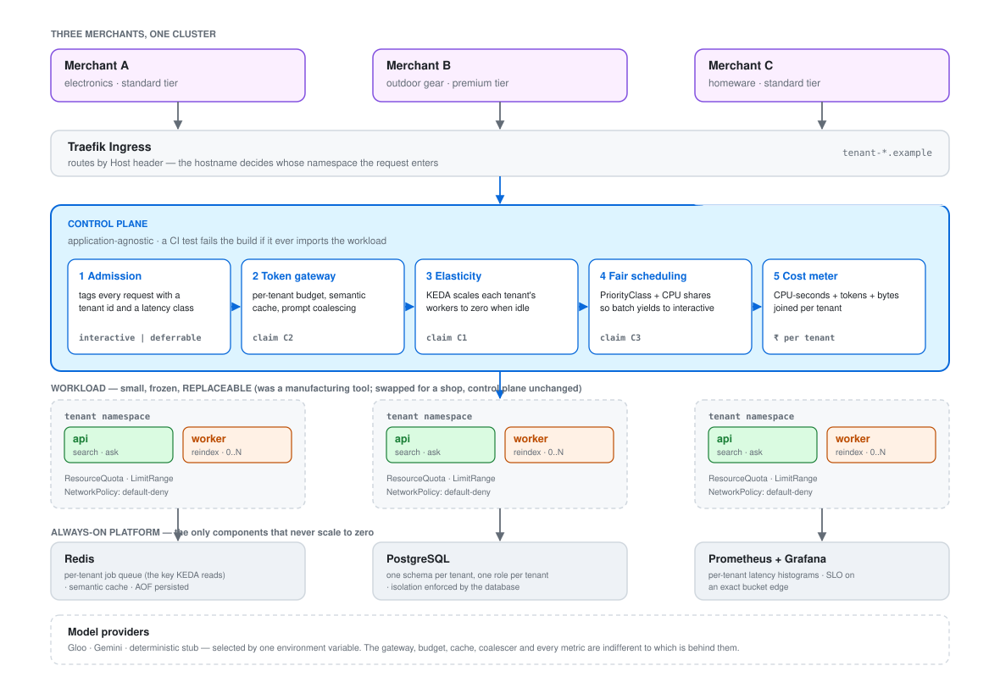

<div align="center">

# Multi-tenant SaaS on Kubernetes

### A cost- and SLO-aware control plane for LLM-backed applications

**Scale each tenant to zero when idle. Cap what any tenant can spend on model tokens.
Keep one customer's batch job from slowing another customer's request.
Then put a rupee figure on every tenant.**

<p>
  
  
  
  
  
  
</p>

<picture>
  <source media="(prefers-color-scheme: dark)" srcset="docs/architecture-dark.svg">
  
</picture>

</div>

---

## Live demo

Three merchants on one cluster. Each is a separate tenant with its own namespace, catalogue, quota and token budget, reached through the same ingress:

| Merchant | Shop |
|---|---|
| Merchant A · electronics · standard tier | [years-similar-ads-occasion.trycloudflare.com/shop](https://years-similar-ads-occasion.trycloudflare.com/shop) |
| Merchant B · outdoor gear · premium tier | [wiring-overcome-replacing-studies.trycloudflare.com/shop](https://wiring-overcome-replacing-studies.trycloudflare.com/shop) |
| Merchant C · homeware · standard tier | [format-relates-quad-reply.trycloudflare.com/shop](https://format-relates-quad-reply.trycloudflare.com/shop) |

> **The links work only while the demo Codespace is running** (these were brought up on 19 October 2026). They are Cloudflare quick tunnels, which get a new random hostname every time they start, and a Codespace sleeps after 30 idle minutes. If a link is dead, [bring the demo back up](#in-a-github-codespace) with two commands; the new links are printed at the end.

To see claim C2 working, ask Merchant B's assistant *"Which jacket works in heavy rain?"* and then ask it again. The first answer is a metered model call. The second comes from that tenant's cache in milliseconds and costs zero tokens.

---

## The problem

One application serving several customers from one cluster has a cost structure that container
orchestration was not designed for:

| # | Problem | Why the platform does not solve it |
| --- | --- | --- |
| **P1** | An idle tenant still costs money — every service stays resident whether the customer logs in or not. | A Kubernetes `Deployment` floors at one replica, and nothing in the default scheduler knows a tenant has had no traffic for eleven hours. |
| **P2** | Model tokens dominate operating cost, and no tenant has a ceiling. | Periodic agents re-ask near-identical questions on a timer. Nothing de-duplicates semantically equivalent prompts, and nothing stops one tenant consuming the entire budget. |
| **P3** | One tenant's batch job slows another tenant's interactive request. | Both are ordinary pods competing for the same CPU. Kubernetes has no notion that one has a user waiting and the other does not. |

## The control plane

Five stages in the request path, and deliberately nothing else.

1. **Admission** — stamps every request with a tenant id and a latency class (`interactive` or `deferrable`).
2. **Token gateway** — the only route to the model. Checks the tenant's remaining budget, serves
   near-duplicate prompts from a per-tenant cache, and collapses identical concurrent prompts into one call.
3. **Elasticity** — KEDA reads each tenant's own queue depth, so a tenant with no traffic holds no pods.
4. **Fair scheduling** — priority classes *and* CPU shares, so deferrable work yields rather than competing.
5. **Cost meter** — joins CPU-seconds, tokens and stored bytes into one rupee figure per tenant.

## Results

Measured on a three-node k3d cluster, three tenants. Raw output is committed under
[`experiments/raw/`](experiments/raw/) — a result whose data is absent is a claim, not a finding.

### C1 · Scale-to-zero

Workers reach **0 replicas** when a tenant is idle. Cold start, timed from job acceptance to queue drained,
6 trials per configuration:

| KEDA `pollingInterval` | median | worst |
| --- | --- | --- |
| 1 s | **3.70 s** | 5.11 s |
| 5 s | **6.01 s** | 14.34 s |

**The penalty is dominated by the scaler's polling interval, not container startup.** Detection delay is
uniform in `[0, P]` with mean `P/2`, predicting a 2.00 s median difference between these settings; the
measured difference is **2.31 s**. Container start is negligible because the image is 15 MB and a Go binary
starts in milliseconds — which makes the cold-start cost a parameter the operator chooses rather than a
fixed price of scale-to-zero.

### C2 · Token spend

A repeated question costs **zero tokens** and returns in ~30 ms instead of ~900 ms. Twenty concurrent
identical prompts collapse to **one** upstream call — the case a cache structurally cannot solve, because a
cache only helps after the first answer returns.

**An honest negative result.** The local lexical embedder scores a *paraphrase* pair at **0.219** and a
*materially different* pair at **0.794** — it ranks the pair that must not merge four times above the pair
that should. No threshold separates them, because the two questions share nearly every word and differ in
the one term carrying the meaning. The cache is therefore configured conservatively: it collapses
near-identical prompts and never answers the wrong question. Paraphrase collapse needs a semantic embedding
model and is stated as future work rather than claimed.

### C3 · Noisy neighbour — partially supported

Victim workload identical in all three phases; only the neighbour and the scheduling configuration change.

| phase | p50 | p95 | p99 |
| --- | --- | --- | --- |
| quiet | 6.5 ms | 26.9 ms | 29.0 ms |
| unprotected | 28.6 ms | **75.2 ms** | 123.7 ms |
| protected | 28.0 ms | **61.4 ms** | 96.5 ms |

Contention is real — p95 degrades 2.8×. Priority classes recover **18% of p95 and 22% of p99**, but do
**not** restore the baseline. C3 as written says class separation *holds* the objective; it does not, it
improves it. Both loaded phases stayed under the 400 ms objective, but that is headroom, not the mechanism
succeeding.

Three caveats are recorded in [`experiments/raw/README.md`](experiments/raw/README.md) rather than dropped:
the degradation is not cleanly attributable to worker CPU alone, KEDA never reached its replica ceiling
because the HPA rate-limits scale-up, and a first attempt measured nothing at all because the node had
12 allocatable CPUs and the tenant quota capped the workers before KEDA got a say.

## The architectural claim, and how it is enforced

The control plane is **application-agnostic**. It keys off an HTTP header, a path classification and a queue
depth, and knows nothing about what the application does.

That is checked, not asserted. [`TestControlPlaneDoesNotImportWorkload`](controlplane/boundary_test.go)
parses every file under `controlplane/` and fails the build if any of them imports `workload/`. It was
verified against a deliberate violation to confirm it fails rather than passing vacuously, and it refuses to
pass if the walk finds no files.

It has also been demonstrated the hard way. The original workload was a **gauge repeatability-and-reproducibility
tool for manufacturing**. It is now an **online shop** — catalogue search, an LLM shopping assistant, and a
CPU-bound "related products" rebuild. Not one line of `controlplane/` changed.

Because `controlplane/` sits outside Go's import-restricted `internal/` directory, another module can import
it directly: the reusability claim is enforced by the compiler, not just described here.

### Swapping in your own application

1. Send `X-Tenant` on every request, and list deferrable routes in `controlplane/admission`.
2. Wrap handlers as `admission.Middleware(obs.Middleware(h))`, so latency is labelled by tenant and class.
3. Reach the model only through `controlplane/model.Client`, and enqueue deferrable work through
   `controlplane/queue`.

## Tenant isolation

Three enforced layers, not one.

| Layer | Mechanism | What it stops |
| --- | --- | --- |
| Network | `NetworkPolicy`, default-deny ingress | tenant-b reaching tenant-a's API — verified by deleting the policy and watching the same request succeed |
| Data | One PostgreSQL schema *and role* per tenant | cross-schema reads; the role holds no grant on anyone else's data |
| Compute | `ResourceQuota` + `LimitRange` per namespace | one tenant consuming the cluster — 12 requested replicas against a 1-CPU quota yielded 2 |
| Model | Cache and coalescer keyed by tenant | one merchant's cached answer reaching another |

## Repository layout

```text
workload/            the demonstration application — small, frozen, REPLACEABLE
  api/               /products (search), /ask (assistant), /reindex (enqueue → 202)
  api/ui/            single-page storefront, served at /shop
  worker/            queue consumer, one per tenant, blocks rather than polls
  catalogue/         domain surface — TF-IDF similarity over a product catalogue
  store/             per-tenant Postgres schema: products, related_products, runs
controlplane/        the deliverable — application-agnostic
  admission/         tenant id + latency-class tagging
  queue/             one Redis list per tenant; the key KEDA scales on
  model/             the only boundary to the model — Gloo, Gemini, stub, fallback
  gateway/           per-tenant budget, semantic cache, prompt coalescing
  obs/               histograms whose buckets put the SLO on an exact edge
  boundary_test.go   fails the build if this package ever imports the workload
deploy/
  charts/tenant/     one Helm release per customer: namespace, quota, NetworkPolicies,
                     ingress, ScaledObject, schema + role provisioning
  k8s/platform/      shared Redis and Postgres — the only always-on components
  k8s/monitoring/    kube-prometheus-stack values and scrape monitors
  k8s/scheduling/    PriorityClasses
  vm-install.sh      one command from a bare Ubuntu VM to the full stack
experiments/
  tenants.py         shift-shaped multi-tenant load model (Locust)
  coldstart.py       E1 — cold-start penalty, claim C1
  noisyneighbour.py  E3 — interference under load, claim C3
  raw/               committed raw output — the evidence behind every number
```

## Running it

Needs Docker, `kubectl`, `k3d`, `helm` and Go 1.25. No cloud account, no payment method.

```bash
make up          # k3d cluster, kubeconfig repair, nodes ready
make monitoring  # kube-prometheus-stack + scrape monitors
make deploy      # Redis, Postgres, images, three tenants
```

Then open `http://tenant-a.localhost:8080/shop`. Onboarding a fourth customer is one command:

```bash
helm install tenant-d deploy/charts/tenant --set tenant=tenant-d --set tier=premium
```

Offboarding is `helm uninstall tenant-d` — the namespace goes and cascades to everything inside it.

### On a public VM

```bash
curl -fsSL https://raw.githubusercontent.com/krizz711/multitenant-saas-on-kubernetes/main/deploy/vm-install.sh | sudo bash
```

Installs k3s, Helm, KEDA and all three tenants, **builds the images natively** so x86 and arm64 both work,
and derives per-tenant hostnames from `nip.io` so no domain or DNS record is required.

### In a GitHub Codespace

This is how the live demo above runs. It needs no card, no cloud account and no student verification. Go to **Code → Codespaces → Create codespace on main**, then in the Codespace terminal:

```bash
bash deploy/codespaces-install.sh   # cluster, images, KEDA, three tenants (about 10 minutes the first time)
bash deploy/codespaces-tunnel.sh    # three public trycloudflare.com links, each checked end to end
```

Export `GLOO_CLIENT_ID` and `GLOO_CLIENT_SECRET` (or `GEMINI_API_KEY`) before the install if you want real model answers. Without them every tenant falls back to stub answers. The shops still look healthy, but claim C2 has nothing to measure.

A Codespace stops after its idle timeout and the public links die with it. After reopening it, `bash deploy/codespaces-resume.sh` restarts the cluster and front doors without touching Helm, and prints fresh links.

The tunnel step exists because some campus DNS resolvers refuse `*.app.github.dev`. On those networks the Codespace's own forwarded URLs fail with NXDOMAIN even though the ports are public and serving. The full walkthrough is in [`deploy/CODESPACES.md`](deploy/CODESPACES.md).

## Why it runs on nothing

| Managed service | What this project runs instead |
| --- | --- |
| Amazon EKS | k3s on a free-tier VM; k3d locally |
| ALB + Route 53 | Traefik ingress on the node |
| Aurora PostgreSQL | Postgres pod, one schema and role per tenant |
| ElastiCache + SQS | one Redis pod — cache and queue, AOF persisted |
| Amazon Bedrock | Gloo or Gemini, behind the same gateway |
| Managed Prometheus / Grafana | self-hosted kube-prometheus-stack |
| Cost Explorer + allocation tags | PromQL recording rules, per tenant |

The Kubernetes API k3s exposes is the one EKS exposes, so every manifest, quota, network policy and
autoscaler config here is byte-identical on a managed cluster. Moving this to EKS changes how the cluster is
*provisioned*, not one line of the control plane — which is the point: a managed control plane bills
continuously whether workloads run or not, and that is the cost model this project argues against.

## Known limitations

Stated here rather than discovered by a reader.

- **The semantic cache is lexical, not semantic.** Measured above; paraphrases are not collapsed.
- **C3 is partially supported.** Priority classes improve the tail by 18%; they do not hold the objective.
- **The model is stubbed during experiments, deliberately.** A rate-limited hosted dependency in the request
  path would contaminate every latency number. Hosted providers are used for demonstrations, and are wrapped
  so an unreachable provider degrades to a local answer rather than returning 502.
- **Cost attribution is partial.** CPU-seconds, tokens and per-schema storage are measured; joining them into
  a single rupee figure is the next piece of work.

## Motivation

The three problems were found in a real system:
[Quality-AI-Intelligence](https://github.com/krizz711/Quality-AI-Intelligence), a multi-agent manufacturing
quality platform that ships as a twelve-service stack, re-analyses every active measurement series through a
language model every thirty seconds, and runs CPU-heavy gauge studies alongside an interactive dashboard.
Pointing this control plane at it is future work — deliberately, so that no result here depends on migrating
a large application first.

## Licence

MIT — see [LICENSE](LICENSE).
